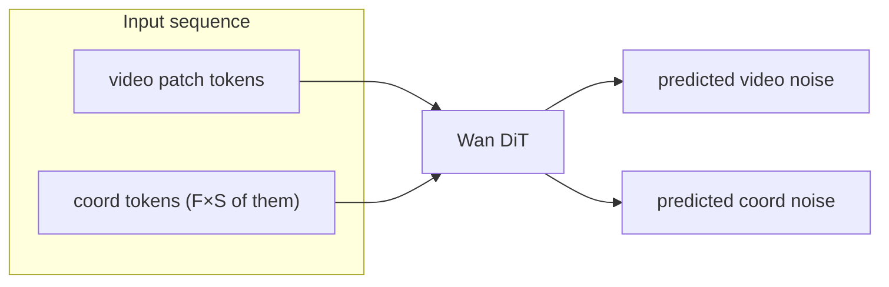

# Method: Coord-Token Diffusion with Spatial-RoPE Cross-Attention

This note explains the architectural additions we made on top of the upstream
Wan2.1 + Self-Forcing DiT so that a single model can generate gameplay video
together with per-player screen coordinates.

## Problem

Pure video diffusion models, given only a text prompt and an initial frame,
have no mechanism to follow *per-player* action sequences in a multi-agent
game (e.g. Melting Pot's ``coins`` has 2 players with 5-7 discrete actions
each, 17 frames per episode). Conditioning on a flat concatenation of all
actions doesn't work well: the model has no grounded notion of *which player
is where* on screen.

## Solution, in one paragraph

We add a small number of extra tokens to the DiT input sequence:

* one **coord token** per ``(frame, player)`` — continuous ``(x, y)`` position
  encoded by a learned linear layer (``coord_encoder``);
* **action tokens** per ``(frame, player)`` — discrete actions looked up in a
  frozen embedding table. Each player's coord tokens cross-attend only to that
  player's actions, while video tokens cross-attend to the game-description
  text; the video sees the actions only through self-attention with the coord
  tokens.

Both sets of tokens carry 3D RoPE over ``(frame, y_patch, x_patch)`` so the
attention can reason about spatial proximity. Coord tokens are denoised jointly
with the video latents (flow matching), while actions are the conditioning
signal.

## Sequence layout

A single sample has:

* Video patch tokens: ``video_len = T_lat * H_lat * W_lat / p^2``
  (e.g. ``5 * 64 * 64 / 2² = 5120`` for 512×512 video, 17 pixel frames).
* Coord tokens: ``T_lat * num_subjects``, in **FRAME-MAJOR** layout
  ``[f0_s0, f0_s1, ..., f0_sS, f1_s0, ...]``.

Concatenated: ``[video_tokens | coord_tokens]``. Both modalities are denoised
by the same DiT; a small prediction head projects coord-token hidden states
back to 2D coordinates.

## Key additions per module

### `wan/modules/coord_token.py` (new)

Standalone helpers extracted from `wan/modules/model.py`:

* :func:`get_self_attn_block_mask` / :func:`get_coord_self_attn_block_mask`
  build cached FlexAttention block masks that isolate each subject's coord
  tokens from other subjects' coord tokens in self-attention. Video tokens
  still see everything so global scene modelling is unaffected.
* :class:`FourierCoordEncoder` maps ``(x, y) ∈ [0, 1]^2`` to a ``dim``-D
  feature vector using sin/cos at ``2^k * π`` frequencies, then optionally
  projects to the model width. It is used only with ``coord_fourier_encoding: true``;
  the shipped configs use the learned linear encoder.

### `wan/modules/model.py`

* :func:`rope_apply` now accepts ``coord_token_info`` and ``position_token_info``
  kwargs so coord tokens carry 3D RoPE computed from their frame index plus
  patchified ``(y, x)``.
* :func:`temporal_rope_apply` applies RoPE *only* along the frame axis (used
  by a subset of ablations).
* ``WanModel._forward`` packs video + coord tokens into one sequence, runs the
  DiT blocks, and unpacks the video and coord outputs. The subject-isolation
  mask for coord tokens is applied in ``WanSelfAttention.forward``.
* :class:`WanTemporalActionCrossAttention` and
  :class:`WanMultiSubjectCrossAttention` are earlier action cross-attention
  variants; none of the shipped configs use them.

### `wan/modules/spatial_cross_attn.py`

* :class:`WanMaskedPositionCrossAttention` (``cross_attn_type:
  masked_position_cross_attn``) is the cross-attention used by all shipped
  configs: video tokens attend to the game-description text, and each
  subject's coord tokens attend only to that subject's action embeddings
  (with 3D RoPE when ``cross_attn_rope: true``).
* :class:`WanSpatialCrossAttention` and :class:`WanCoordActionCrossAttention`
  are alternative spatial-RoPE variants sharing the same RoPE computation;
  none of the shipped configs use them.

## Loss

Both video and coord tokens are trained with flow matching loss
(``denoising_loss_type: flow``). Coord loss is additionally weighted by
``coord_loss_weight`` and masked by a ``subject_mask`` so padded players
(games with fewer than ``num_subjects_total`` active agents) don't pull
gradients.

## FAQ

**Why not just predict 2D coords with an MLP head?**  Because we need the
prediction to be autoregressive over frames *and* coupled to the pixels. By
using the same DiT and the same diffusion process, coord tokens see every
video token at every layer — they can hedge their position prediction on the
emerging scene and vice versa.

**Why FlexAttention and not a dense mask?**  With up to 8 players × 5 latent
frames, the added tokens are small (~40) compared to the 5120 video tokens,
but dense masking over the concatenated 5160-token sequence still doubles the
attention memory. FlexAttention compiles the block mask once and keeps
attention effectively dense-fast.

**Why both coord tokens *and* spatial-RoPE cross-attention?**  Coord tokens
give the DiT a continuous representation of where each player is *right now*;
spatial-RoPE cross-attention lets the DiT *condition on the next action*
anchored to that location. One without the other works but is worse in
practice — see the ablation set (exp-141 through 145).
