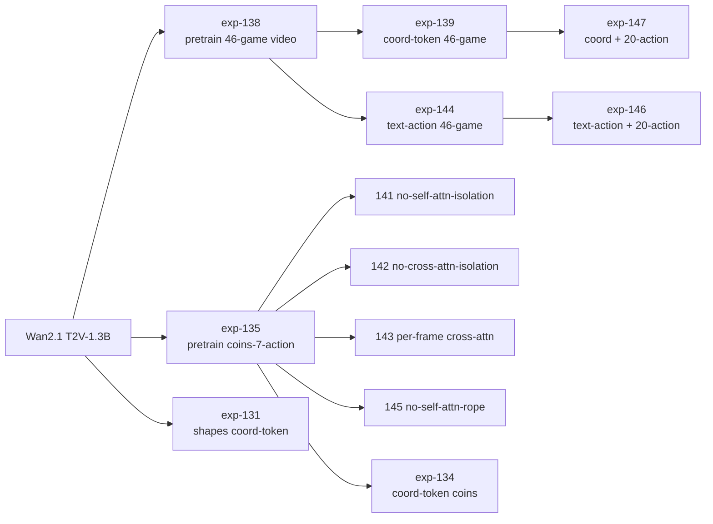

# Training Recipes

Every config in ``configs/exp-*.yaml`` is consumed by the same
entry point:

```bash
torchrun --nproc_per_node=<N_GPUS> --max_restarts=0 \
    train.py --config_path configs/<config>.yaml
```

Checkpoints land under ``checkpoints/<config_name>/checkpoint_model_XXXXXX/model.pt``.
All configs use ``lr=1e-4``, ``beta1=0.9``, ``beta2=0.99``, flow matching
loss, UniPC sampler for validation, and gradient checkpointing.

## Dependency graph



## Per-config table

| Config                                | Starts from                  | batch | iters    | Dataset                                         | Notes                                                   |
|---------------------------------------|------------------------------|-------|----------|-------------------------------------------------|---------------------------------------------------------|
| **exp-131** coord-token-fixed-rope | Wan 1.3B                     | 8     | 10k      | random-blob shapes (2 subjects)                 | Proof-of-concept on synthetic shapes; no Melting Pot.   |
| exp-135 base-wan-pretrain-original-actions | Wan 1.3B                     | 8     | 10k      | coins (7-action)                               | Video-only base for the coins-ablation family.          |
| exp-134 coord-token-original-actions | 135                           | 8     | 10k      | coins (7-action)                               | Coord-token diffusion on coins.                         |
| **exp-138** base-wan-pretrain-multi-game-512 | Wan 1.3B                     | 4     | 5k       | melting_pot_all_games_512_2k                    | 46-game video-only pretrain used by all 512-size configs. |
| **exp-139** multi-game-coord-512 | 138                          | 4     | 50k      | melting_pot_all_games_512_2k                    | **Headline method**: coord-token diffusion, 46 games.   |
| exp-141 no-self-attn-isolation  | 135                           | 32    | 10k      | coins (7-action)                               | Ablation: drop subject-isolated self-attention mask.    |
| exp-142 no-cross-attn-isolation | 135                           | 32    | 10k      | coins (7-action)                               | Ablation: drop per-subject masking in cross-attention.  |
| exp-143 per-frame-cross-attn-coord | 135                        | 32    | 10k      | coins (7-action)                               | Ablation: per-frame (not per-subject) cross-attention.  |
| exp-144 text-action-history-512 | 138                          | 8     | 50k      | melting_pot_all_games_512_2k                    | Baseline: encode action history as text, no coord tokens. |
| exp-145 no-self-attn-rope-coord | 135                           | 16    | 10k      | coins (7-action)                               | Ablation: drop RoPE on coord tokens in self-attention.  |
| exp-146 text-action-20actions-512 | 144                           | 8     | 50k      | melting_pot all-games-20action variant          | Full 25-action vocabulary via text encoding.            |
| exp-147 coord-20actions-512     | 139                           | 8     | 50k      | melting_pot all-games-20action variant          | Coord-token counterpart to 146 (headline + 20 actions). |

## Expected compute

All numbers are wall-clock on a single A100-80G; multi-GPU scales roughly
linearly up to 8 GPUs (the dataloader bound starts to matter past 8).

* exp-138: ~0.75 GPU-day
* exp-139: ~7 GPU-days (50k iters, effective batch 4)
* Smaller coins-ablation configs (141/142/143/145): ~1 GPU-day each
* exp-131 shapes: ~0.5 GPU-day

Effective batch size at multiple GPUs scales as ``batch_size * num_gpus``
with no gradient accumulation. Adjust ``batch_size`` in the YAML if you are
on smaller hardware.

## Logging

Weights & Biases logging is **disabled by default** (``configs/default_config.yaml``
sets ``disable_wandb: true``). To enable it, set ``wandb_entity`` (and optionally
``wandb_project``) to your own account and flip ``disable_wandb: false``; the API key
is read from the ``WANDB_API_KEY`` environment variable. Pass ``--disable-wandb`` to
keep it off explicitly. Sample grids and per-game validation GIFs are written to
``outputs/<run_name>/`` regardless of the W&B setting.

## Resuming

```bash
torchrun ... train.py \
    --config_path configs/exp-139-multi-game-coord-512.yaml \
    --resume_from_checkpoint checkpoints/exp-139-multi-game-coord-512/checkpoint_model_010000
```
